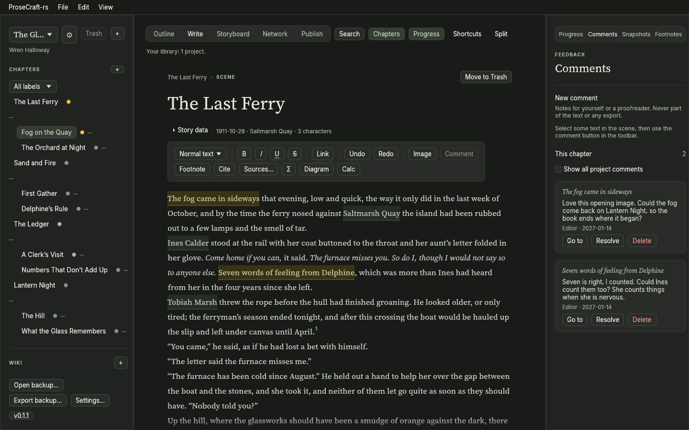
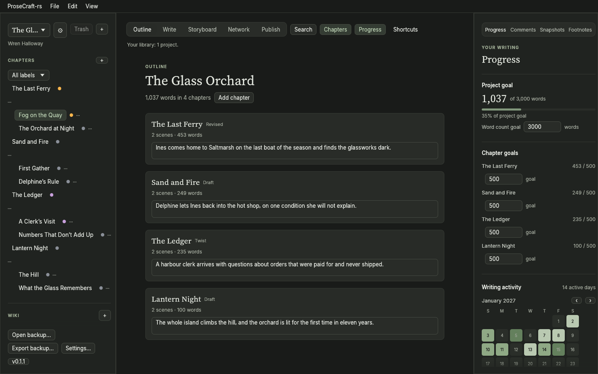
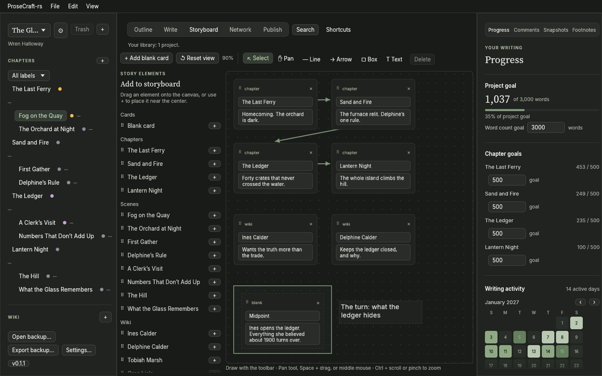
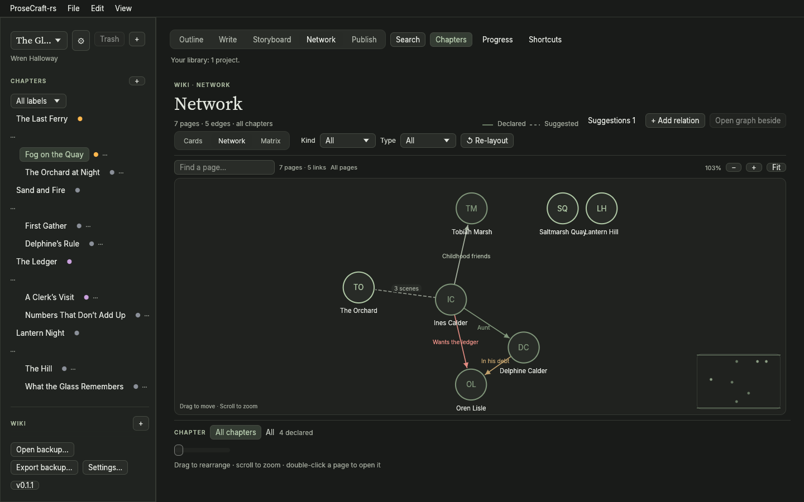
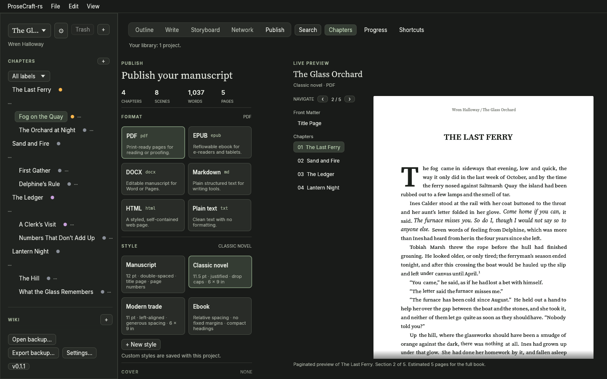
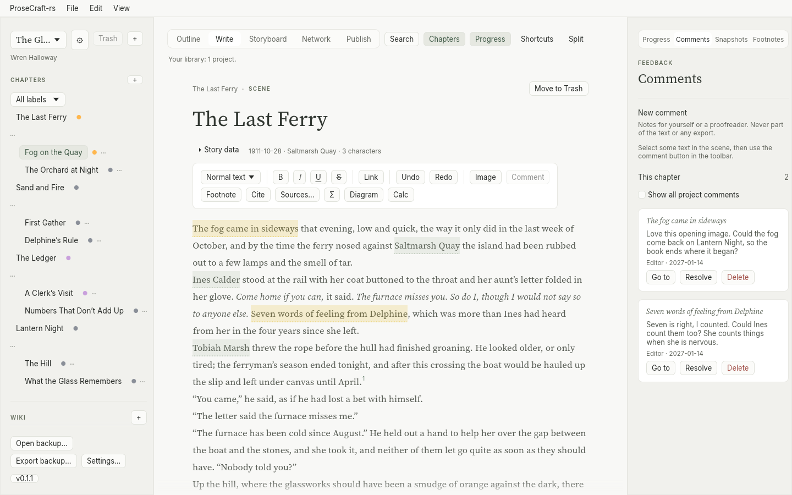

<h1 align="center">ProseCraft-rs</h1>

<p align="center">
  <b>Outline. Write. Publish.</b> A novel-writing app, written in Rust with egui.
</p>

<p align="center">
  Chapters and scenes, a wiki for your characters and places, a storyboard, a relationship network, and a
  publisher that makes the PDF, EPUB or DOCX. It runs natively on Linux, macOS, Windows and BSD and in the
  browser, and opens your ProseCraft backups and sync folders without losing anything.
</p>

> [!NOTE]
> **ProseCraft-rs is an independent Rust rewrite of [ProseCraft](https://github.com/jennraeross/ProseCraft)** by Jennifer Roylance and contributors, used under the MIT licence. It is not affiliated with or endorsed by the ProseCraft project. For the original app, go to [ProseCraft](https://github.com/jennraeross/ProseCraft). Report problems with ProseCraft-rs here, not there.

> [!CAUTION]
> 🚧 **0.1.x: an early release.** It does what ProseCraft does (up to upstream `8cdc694`, v0.6.1), but it is
> new: it has not been run on a Mac yet, and it hasn't carried a whole book. Keep backups, and keep your
> ProseCraft copy until you trust it. Report problems as [issues](https://github.com/jonasbove/ProseCraft-rs/issues).

<p align="center">
  
  
  
  
</p>

<p align="center">
  <a href="#build-from-source"><b>Build from source</b></a> ·
  <a href="design/README.md"><b>The design</b></a> ·
  <a href="https://getartcraft.com/apps">The Craft App Suite</a>
</p>

<br>

<p align="center">
  
  <br><sub>Writing a scene, with an editor's comments beside it. The novel in every picture, <i>The Glass Orchard</i>, was made up for them.</sub>
</p>

<p align="center">
  <a href="#features">Features</a> ·
  <a href="#a-tour">A tour</a> ·
  <a href="#under-the-hood">Under the hood</a> ·
  <a href="#status">Status</a> ·
  <a href="#build-from-source">Build from source</a> ·
  <a href="#the-craft-app-suite">Craft App Suite</a> ·
  <a href="#license-and-credits">License</a>
</p>

## Features

<table>
  <tr>
    <td width="33%" valign="top">
      <h3>✍️ Writing first</h3>
      A quiet serif column with footnotes, citations (Zotero, BibTeX, RIS, CSL), comments, snapshots,
      equations, diagrams, calculations and offline spelling and grammar. Focus, Zen and typewriter modes
      for when you want nothing else on screen.
    </td>
    <td width="33%" valign="top">
      <h3>🗂️ The whole book at a glance</h3>
      Chapters and scenes in a binder with drag and drop and labels, an outline with summaries and word
      goals, a freeform storyboard, a timeline, and a calendar of the days you wrote.
    </td>
    <td width="33%" valign="top">
      <h3>🕸️ A wiki that knows your cast</h3>
      Pages for characters and places, with character sheets, files and web links. Their names are marked
      in the text, and a relationship network shows who is family, friend, rival or love, chapter by chapter.
    </td>
  </tr>
  <tr>
    <td width="33%" valign="top">
      <h3>📚 Publish it</h3>
      PDF, EPUB, DOCX, HTML, Markdown, plain text and screenplay formats, with covers, front and back
      matter, four built-in styles and your own, and a paginated preview while you choose.
    </td>
    <td width="33%" valign="top">
      <h3>🔒 Your manuscript is safe</h3>
      ProseCraft backups and sync folders open without losing anything: what this app doesn't understand
      is kept and written back. Saves are atomic, and backups can be encrypted.
    </td>
    <td width="33%" valign="top">
      <h3>🦀 Native, everywhere</h3>
      One Rust codebase drawn with egui: a desktop app for Linux, macOS, Windows and BSD, and a web build.
      No webview, no Electron, no Node. Plus a local MCP server for sync folders.
    </td>
  </tr>
</table>

## A tour

<p align="center">
  
  <br><sub><b>Outline.</b> Every chapter with its summary, label and word count, and the goals and writing calendar beside them.</sub>
</p>

<p align="center">
  
  <br><sub><b>Storyboard.</b> Chapters, scenes, wiki pages and blank cards on a canvas, with lines, arrows, boxes and notes drawn around them.</sub>
</p>

<p align="center">
  
  <br><sub><b>Network.</b> The relations between your wiki's pages, and the ones the text suggests: Ines and the Orchard share three scenes.</sub>
</p>

<p align="center">
  
  <br><sub><b>Split view.</b> Up to five reference panes beside the text: wiki pages, other scenes, files, or a graph of the scene's characters.</sub>
</p>

<p align="center">
  
  <br><sub><b>Publish.</b> Choose the format and the style, and turn the pages of the book before you save it.</sub>
</p>

<p align="center">
  
  <br><sub><b>Focus mode.</b> Ctrl+Shift+Enter hides everything but the scene.</sub>
</p>

<p align="center">
  
  <br><sub><b>Colour schemes.</b> ProseCraft's own palette and seven more: Nord, Gruvbox, Solarized, Catppuccin, Everforest, Rosé Pine and Dracula.</sub>
</p>

<p align="center">
  
  <br><sub><b>Light.</b> Every scheme comes light and dark, or follows your system.</sub>
</p>

The pictures are the app itself, rendered offscreen; [design/README.md](design/README.md#screenshots) says how to
make them again.

## Under the hood

A Cargo workspace laid out like the other Craft apps:

| Path | What it is |
|---|---|
| `crates/core` | The project model, ProseCraft's HTML dialect, the storage formats (backup, encrypted backup, open sync folder), sync merge, undo, search and replace, publishing and import. No UI and no I/O policy; it builds for wasm |
| `crates/ui-egui` | Every screen, the manuscript editor included, shared by the desktop and web apps |
| `crates/native` | The library file (atomic saves, `.bak`) and the data folder on the desktop |
| `apps/prosecraft-rs` | The desktop app |
| `apps/prosecraft-rs-web` | The web build (Trunk) |
| `apps/prosecraft-mcp` | A local MCP server for ProseCraft open-folder sync directories, over stdio |
| `xtask` | `cargo xtask ci`: fmt, clippy, tests, the layering check and the wasm check |

Compatibility with ProseCraft is tested against fixtures, not memory: the files in
[`crates/core/tests/fixtures/`](crates/core/tests/fixtures/README.md) were written by ProseCraft's own TypeScript,
and the round-trip tests hold backups, encrypted backups, sync folders, the HTML dialect and the exports to
them. Shared file-format, codec and UI pieces come from [craft-libs](https://github.com/storytold/craft-libs).

The design language (colour tokens, type, layout and components) is written up in
[design/README.md](design/README.md). Also in `docs/`: [ROADMAP.md](docs/ROADMAP.md) and
[upstream-sync.md](docs/upstream-sync.md) (how ProseCraft's changes are followed).

## Status

ProseCraft-rs is **early**: 0.1.1 is the current release. It matches ProseCraft up to upstream
[`8cdc694`](https://github.com/jennraeross/ProseCraft/commit/8cdc694) (v0.6.1).

**Different on purpose:** the look is ProseCraft's, but where a web page and a native egui app differ, it
follows the egui and Craft conventions, and it publishes an AccessKit tree for screen readers. The few palette
text colours that missed 4.5:1 contrast are adjusted. Folder sync is ported; ProseCraft's Google Drive sync is
not, and cloud sync is planned through [CraftCloud](https://github.com/jonasbove/craftcloud) instead.

**Known limits:**
- the macOS native menu has only been compile-checked;
- the desktop clipboard handling has only been tested headlessly;
- on the web, pasting a copied image file does nothing.

> [!IMPORTANT]
> Keep a backup of your book, and keep your ProseCraft copy until you trust ProseCraft-rs with it.

## Build from source

The fonts (Inter for the interface, Source Serif 4 for the manuscript) come from a checkout of
[craft-fonts](https://github.com/storytold/craft-fonts); without it the app builds and uses egui's
and your system's fonts.

```sh
git clone https://github.com/storytold/craft-fonts ../craft-fonts
export CRAFT_FONTS_DIR=$PWD/../craft-fonts
cargo run -p prosecraft-rs            # desktop
cargo xtask ci                        # fmt, clippy, tests, layers, wasm check
cd apps/prosecraft-rs-web && trunk build --release   # web build into dist/web
```

## The Craft App Suite

ProseCraft-rs follows the house rules of the Craft apps, a family of native creative tools written in Rust:
[getartcraft.com/apps](https://getartcraft.com/apps). Its sister project
[CraftCloud](https://github.com/jonasbove/craftcloud) is a self-hosted sync folder for them, and the way
ProseCraft-rs is meant to sync between computers.

## License and credits

`MIT OR Apache-2.0`, see [LICENSE-MIT](LICENSE-MIT) and [LICENSE-APACHE](LICENSE-APACHE).

ProseCraft-rs is a rewrite of ProseCraft, © 2026 Jennifer Roylance, MIT licence. That copyright and permission notice is kept in [LICENSE-MIT](LICENSE-MIT) and [NOTICE](NOTICE), and every asset or text taken from ProseCraft is listed in [ATTRIBUTION.md](ATTRIBUTION.md). Thank you to Jennifer and the ProseCraft contributors for building it and sharing it openly.

ProseCraft-rs is independent: it is not affiliated with or endorsed by the ProseCraft project. Report problems
with ProseCraft-rs [here](https://github.com/jonasbove/ProseCraft-rs/issues), not to ProseCraft.

The screenshots, and *The Glass Orchard*, the novel in them, are original to this repository (see
[ATTRIBUTION.md](ATTRIBUTION.md)).
