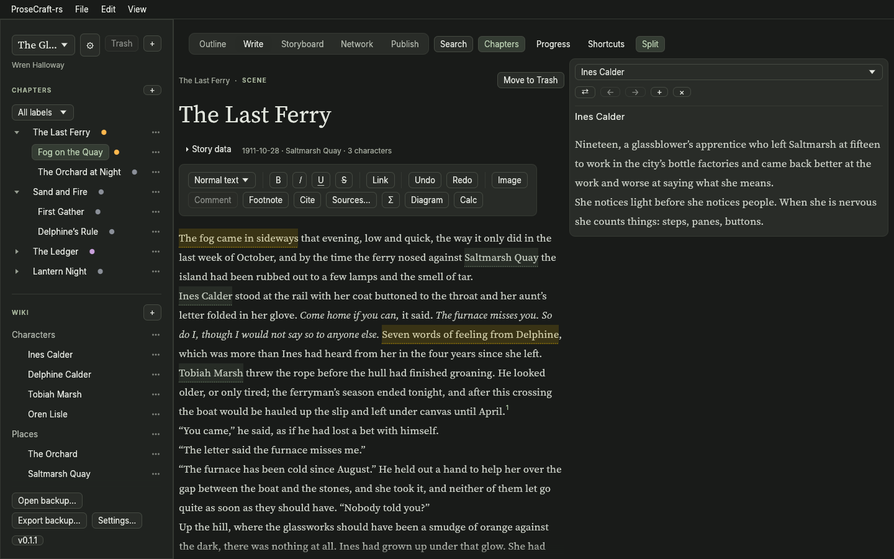
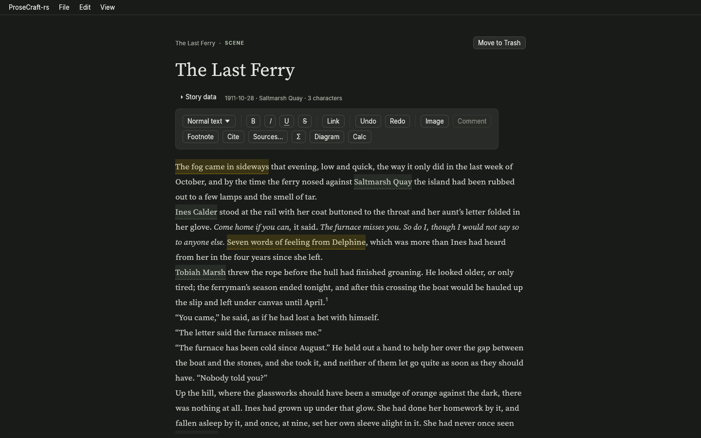
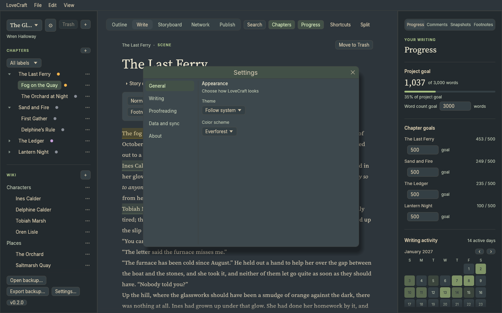

<p align="center">
  
</p>

<h1 align="center">LoveCraft</h1>

<p align="center">
  <b>LoveCraft: a native Rust rewrite of ProseCraft.</b> Outline, write and publish a novel, in an app written
  in Rust with egui.
</p>

<p align="center">
  Chapters and scenes, a wiki for your characters and places, a storyboard, a relationship network, and a
  publisher that makes the PDF, EPUB or DOCX. It runs natively on Linux, macOS, Windows and BSD and in the
  browser, and opens your ProseCraft backups and sync folders without losing anything.
</p>

> [!NOTE]
> **LoveCraft is an independent Rust rewrite of [ProseCraft](https://github.com/jennraeross/ProseCraft)** by Jennifer Roylance and contributors, used under the MIT licence. It is not affiliated with or endorsed by the ProseCraft project. For the original app, go to [ProseCraft](https://github.com/jennraeross/ProseCraft). Report problems with LoveCraft here, not there. Until version 0.2.0 it was called **ProseCraft-rs**; its old commands (`prosecraft-rs`, `prosecraft-mcp`) still work, and updating keeps your library.

> [!CAUTION]
> 🚧 **0.2: an early release.** It does what ProseCraft does (up to upstream `8cdc694`, v0.6.1), but it is
> new: it has not been run on a Mac yet, and it hasn't carried a whole book. Keep backups, and keep your
> ProseCraft copy until you trust it. Report problems as [issues](https://github.com/jonasbove/LoveCraft/issues).

<p align="center">
  
  
  
  
</p>

<p align="center">
  <a href="#downloads"><b>Downloads</b></a> ·
  <a href="#build-from-source"><b>Build from source</b></a> ·
  <a href="design/README.md"><b>The design</b></a> ·
  <a href="https://getartcraft.com/apps">The Craft App Suite</a>
</p>

<br>

<p align="center">
  
  <br><sub>Writing a scene, with an editor's comments beside it. The novel in every picture, <i>The Glass Orchard</i>, was made up for them.</sub>
</p>

<p align="center">
  <a href="#features">Features</a> ·
  <a href="#a-tour">A tour</a> ·
  <a href="#under-the-hood">Under the hood</a> ·
  <a href="#status">Status</a> ·
  <a href="#build-from-source">Build from source</a> ·
  <a href="#the-craft-app-suite">Craft App Suite</a> ·
  <a href="#license-and-credits">License</a>
</p>

## Features

<table>
  <tr>
    <td width="33%" valign="top">
      <h3>✍️ Writing first</h3>
      A quiet serif column with footnotes, citations (Zotero, BibTeX, RIS, CSL), comments, snapshots,
      equations, diagrams, calculations and offline spelling and grammar. Focus, Zen and typewriter modes
      for when you want nothing else on screen.
    </td>
    <td width="33%" valign="top">
      <h3>🗂️ The whole book at a glance</h3>
      Chapters and scenes in a binder with drag and drop and labels, an outline with summaries and word
      goals, a freeform storyboard, a timeline, and a calendar of the days you wrote.
    </td>
    <td width="33%" valign="top">
      <h3>🕸️ A wiki that knows your cast</h3>
      Pages for characters and places, with character sheets, files and web links. Their names are marked
      in the text, and a relationship network shows who is family, friend, rival or love, chapter by chapter.
    </td>
  </tr>
  <tr>
    <td width="33%" valign="top">
      <h3>📚 Publish it</h3>
      PDF, EPUB, DOCX, HTML, Markdown, plain text and screenplay formats, with covers, front and back
      matter, four built-in styles and your own, and a paginated preview while you choose.
    </td>
    <td width="33%" valign="top">
      <h3>🔒 Your manuscript is safe</h3>
      ProseCraft backups and sync folders open without losing anything: what this app doesn't understand
      is kept and written back. Saves are atomic, and backups can be encrypted.
    </td>
    <td width="33%" valign="top">
      <h3>🦀 Native, everywhere</h3>
      One Rust codebase drawn with egui: a desktop app for Linux, macOS, Windows and BSD, and a web build.
      No webview, no Electron, no Node. Plus a local MCP server for sync folders.
    </td>
  </tr>
</table>

## A tour

<p align="center">
  
  <br><sub><b>Outline.</b> Every chapter with its summary, label and word count, and the goals and writing calendar beside them.</sub>
</p>

<p align="center">
  
  <br><sub><b>Storyboard.</b> Chapters, scenes, wiki pages and blank cards on a canvas, with lines, arrows, boxes and notes drawn around them.</sub>
</p>

<p align="center">
  
  <br><sub><b>Network.</b> The relations between your wiki's pages, and the ones the text suggests: Ines and the Orchard share three scenes.</sub>
</p>

<p align="center">
  
  <br><sub><b>Split view.</b> Up to five reference panes beside the text: wiki pages, other scenes, files, or a graph of the scene's characters.</sub>
</p>

<p align="center">
  
  <br><sub><b>Publish.</b> Choose the format and the style, and turn the pages of the book before you save it.</sub>
</p>

<p align="center">
  
  <br><sub><b>Focus mode.</b> Ctrl+Shift+Enter hides everything but the scene.</sub>
</p>

<p align="center">
  
  <br><sub><b>Colour schemes.</b> ProseCraft's own palette and seven more: Nord, Gruvbox, Solarized, Catppuccin, Everforest, Rosé Pine and Dracula.</sub>
</p>

<p align="center">
  
  <br><sub><b>Light.</b> Every scheme comes light and dark, or follows your system.</sub>
</p>

The pictures are the app itself, rendered offscreen; [design/README.md](design/README.md#screenshots) says how to
make them again.

## Under the hood

A Cargo workspace laid out like the other Craft apps:

| Path | What it is |
|---|---|
| `crates/core` | The project model, ProseCraft's HTML dialect, the storage formats (backup, encrypted backup, open sync folder), sync merge, undo, search and replace, publishing and import. No UI and no I/O policy; it builds for wasm |
| `crates/ui-egui` | Every screen, the manuscript editor included, shared by the desktop and web apps |
| `crates/native` | The library file (atomic saves, `.bak`) and the data folder on the desktop |
| `apps/prosecraft-rs` | The desktop app |
| `apps/prosecraft-rs-web` | The web build (Trunk) |
| `apps/prosecraft-mcp` | A local MCP server for ProseCraft open-folder sync directories, over stdio |
| `xtask` | `cargo xtask ci`: fmt, clippy, tests, the layering check and the wasm check |

Compatibility with ProseCraft is tested against fixtures, not memory: the files in
[`crates/core/tests/fixtures/`](crates/core/tests/fixtures/README.md) were written by ProseCraft's own TypeScript,
and the round-trip tests hold backups, encrypted backups, sync folders, the HTML dialect and the exports to
them. Shared file-format, codec and UI pieces come from [craft-libs](https://github.com/storytold/craft-libs).

The design language (colour tokens, type, layout and components) is written up in
[design/README.md](design/README.md). Also in `docs/`: [ROADMAP.md](docs/ROADMAP.md) and
[upstream-sync.md](docs/upstream-sync.md) (how ProseCraft's changes are followed).

## Status

LoveCraft is **early**: 0.3.0 is the current release. It matches ProseCraft up to upstream
[`8cdc694`](https://github.com/jennraeross/ProseCraft/commit/8cdc694) (v0.6.1).

**Different on purpose:** the look is ProseCraft's, but where a web page and a native egui app differ, it
follows the egui and Craft conventions, and it publishes an AccessKit tree for screen readers. The few palette
text colours that missed 4.5:1 contrast are adjusted. Folder sync is ported; ProseCraft's Google Drive sync is
not; cloud sync goes through [CraftCloud](https://github.com/jonasbove/craftcloud) instead (see [CraftCloud](#craftcloud)).

**Known limits:**
- the macOS native menu has only been compile-checked;
- the desktop clipboard handling has only been tested headlessly;
- on the web, pasting a copied image file does nothing.

> [!IMPORTANT]
> Keep a backup of your book, and keep your ProseCraft copy until you trust LoveCraft with it.

## Downloads
Every release from 0.1.2 on, on the [releases page](https://github.com/jonasbove/LoveCraft/releases) has
packages for every system, each with the app (`lovecraft`) and the MCP server (`lovecraft-mcp`). Before 0.2.0
the files and commands were named `prosecraft-rs`; every package still installs `prosecraft-rs` and
`prosecraft-mcp` as aliases (deprecated), and the 0.2 packages replace the `prosecraft-rs` ones. The app also
comes from the Nix flake or from source. `<ver>` is the version number, for example `0.3.0`.

The builds are **not code-signed** by Apple or Microsoft yet, so your system asks once before the first start.

**Windows** (10 and 11, x64 and arm64)

| File | What it is |
|---|---|
| `lovecraft-<ver>-windows-{x64,arm64}.msi` | Installer, for you only (no administrator rights). SmartScreen: **More info › Run anyway**. Adds LoveCraft to the Start menu and to "Open with" for `.prosecraft` backups, and puts `lovecraft-mcp` on your PATH. It updates a ProseCraft-rs install in its folder |
| `lovecraft-<ver>-windows-{x64,arm64}-portable.zip` | The same `lovecraft.exe` and `lovecraft-mcp.exe`, to run without installing |

**macOS** (11 or later, Apple silicon and Intel)

| File | What it is |
|---|---|
| `lovecraft-<ver>-macos-universal.dmg` | Drag `LoveCraft.app` to Applications, then **right-click › Open › Open** the first time (or `xattr -dr com.apple.quarantine /Applications/LoveCraft.app`). The MCP server is `LoveCraft.app/Contents/MacOS/lovecraft-mcp`. Updating from ProseCraft-rs, delete `ProseCraft-rs.app` afterwards |

**Linux** (x86_64 and aarch64)

| File | What it is |
|---|---|
| `lovecraft-<ver>-linux-<arch>.deb` | Debian, Ubuntu, Mint, Pop!_OS (`sudo apt install ./lovecraft-….deb`) |
| `lovecraft-<ver>-linux-<arch>.rpm` | Fedora, openSUSE, RHEL (`sudo dnf install ./lovecraft-….rpm`) |
| `lovecraft-<ver>-linux-<arch>.pkg.tar.zst` | Arch Linux (`sudo pacman -U lovecraft-….pkg.tar.zst`); AUR recipes are in `packaging/arch/` |
| `lovecraft-<ver>-linux-<arch>.flatpak` | Flatpak (`flatpak install --user lovecraft-….flatpak`); the MCP server is `flatpak run --command=lovecraft-mcp io.github.jonasbove.prosecraft_rs` |
| `lovecraft-<ver>-linux-<arch>.AppImage` | Any distro: make it executable and run it; with `--mcp` first it runs the MCP server. The `.zsync` next to it lets AppImage updaters fetch only what changed (a copy named `prosecraft-rs-<ver>-…` is there for ProseCraft-rs 0.1 AppImages, whose updater looks for that name) |
| `lovecraft-<ver>-linux-<arch>.tar.gz` | The binaries, menu entry, file type, icons and `install.sh` |

```sh
tar xzf lovecraft-<ver>-linux-x86_64.tar.gz
cd lovecraft-<ver>-linux-x86_64
./install.sh            # to ~/.local, no root; ./install.sh --remove undoes it
```

The packages register LoveCraft for `.prosecraft` backups, so the file manager opens them with it.
FreeBSD (`lovecraft-<ver>-freebsd-{x86_64,aarch64}.tar.gz`) and Linux riscv64 (`.deb`, `.rpm`, `.tar.gz`)
builds are made too, but LoveCraft has not been tried on them; a release may come without them.
Installing, updating or removing a package never touches your library.

**Web** (any current browser)

| File | What it is |
|---|---|
| `lovecraft-web-<ver>.zip` | The web app: one folder, `lovecraft-web-<ver>/`, to put on any static web server, at the top or under a sub-path (its file URLs are relative). It keeps its library in the browser (IndexedDB) |

**Running inside CraftCloud.** [CraftCloud](https://github.com/jonasbove/craftcloud) serves the Craft apps' web
builds under `/apps/<app>/` (this one under its id, as `/apps/prosecraft-rs/`), and its web file browser opens a file in its app
through the Craft host messages. Given a `.prosecraft` backup that way, the app edits that file instead of the
browser's library: it shows the file's projects, and sends them back to be saved as a ProseCraft backup under the
same name, after a pause in writing (at most every 15 seconds) or at once with Ctrl+S (⌘S). It tells the host
when there are unsaved changes, so the host can warn before you leave. It sends one save at a time and the next only once the
host has answered `saved` (a save unanswered after 30 seconds is reported, and holds the next one back), so a
host must store a file's saves in the order they come, one after another. When the page is hidden or closed,
what was typed is sent at once. A file from a newer ProseCraft and an
encrypted backup open read-only and are never written back; a file that isn't a backup is refused with a message.
The browser's own library is not opened or changed while the app runs inside CraftCloud. Any page on the same
origin can host it the same way: it speaks `craft-web-host`'s messages (`prosecraft-rs:open`, `:save`,
`:saved`, `:dirty`, `:failed`) when its URL has `?host=parent`.

**Checking a download**

Every release has `SHA256SUMS.txt`. Check the files you downloaded against it:

```sh
sha256sum -c SHA256SUMS.txt --ignore-missing              # macOS: shasum -a 256 -c SHA256SUMS.txt --ignore-missing
```

Every file also has a GPG signature (`.asc`) next to it, made with the release key
`29E57E45001D294F72E2EC80C42E3F3BDD6A7FF4`, named "ProseCraft-rs releases" (LoveCraft's former name; its signing subkey is
`F518B82ABC37347A5ADF0CB322B89C26692F6185`, valid until 2028-11-18). Its public key is `release-signing-key.asc`,
on every release and in this repository. Import it once and check that the fingerprint matches, then:

```sh
gpg --import release-signing-key.asc
gpg --verify SHA256SUMS.txt.asc SHA256SUMS.txt
gpg --verify lovecraft-<ver>-linux-x86_64.AppImage.asc lovecraft-<ver>-linux-x86_64.AppImage
```

Each file also carries a signed build-provenance attestation that ties it to this repository's release workflow
and the commit it was built from ([GitHub CLI](https://cli.github.com)):

```sh
gh attestation verify lovecraft-<ver>-macos-universal.dmg --repo jonasbove/LoveCraft
```

**Nix and NixOS**

```sh
nix run github:jonasbove/LoveCraft                  # the app
nix run github:jonasbove/LoveCraft#lovecraft-mcp   # the MCP server
```

To keep it installed, add the flake as an input and install its package
(`inputs.lovecraft.packages.${pkgs.stdenv.hostPlatform.system}.default`, in `environment.systemPackages` or
Home Manager's `home.packages`). It brings its own menu entry, file type and icons.

How a release is made: [docs/RELEASING.md](docs/RELEASING.md). What changed: [docs/RELEASE-NOTES.md](docs/RELEASE-NOTES.md).

## Build from source

The fonts (Inter for the interface, Source Serif 4 for the manuscript) come from a checkout of
[craft-fonts](https://github.com/storytold/craft-fonts); without it the app builds and uses egui's
and your system's fonts.

```sh
git clone https://github.com/storytold/craft-fonts ../craft-fonts
export CRAFT_FONTS_DIR=$PWD/../craft-fonts
cargo run -p prosecraft-rs            # desktop (the crates keep their first name)
cargo xtask ci                        # fmt, clippy, tests, layers, wasm check
cd apps/prosecraft-rs-web && trunk build --release   # web build into dist/web
```

## CraftCloud

[CraftCloud](https://github.com/jonasbove/craftcloud) is the Craft apps' self-hosted sync, and how LoveCraft
syncs between computers instead of ProseCraft's Google Drive. With CraftCloud's desktop client installed (its
`craftcloud` program on `PATH`), the desktop app offers:

- **File › Open from CraftCloud…** (also beside Open backup… under the binder): the ProseCraft backups CraftCloud
  has, newest first, each with how it stands with the sync. One that isn't on this computer yet is greyed out;
  the others open as Open backup… opens a file.
- **File › Save to CraftCloud…**: the open project as a backup of its own, `<project>.prosecraft`, into
  CraftCloud's `LoveCraft` folder. The window stays usable while CraftCloud uploads it; a file of that name
  already there is replaced only after you say so, and CraftCloud keeps the one it replaced among its versions.
- **Settings › Data and sync › In CraftCloud**: device sync through a folder inside CraftCloud's sync folder,
  `LoveCraft/<method>`, with any of the three methods. When a file changed on two computers, CraftCloud keeps
  both: the original syncs, and its conflict copy (`doc-1 (conflict 2026-11-13 14.32 Laptop).md`) is never read
  as a second scene and never deleted. The sync says which copies it found, so you can bring in what they hold.

LoveCraft never talks to the CraftCloud server and never sees your sign-in: it runs `craftcloud … --json`, as
CraftCloud's [integration contract](https://github.com/jonasbove/craftcloud/blob/main/docs/CRAFT-INTEGRATION.md)
describes. Without CraftCloud none of this shows, and the web build doesn't offer it.

## The Craft App Suite

LoveCraft follows the house rules of the Craft apps, a family of native creative tools written in Rust:
[getartcraft.com/apps](https://getartcraft.com/apps). Its sister project
[CraftCloud](https://github.com/jonasbove/craftcloud) is a self-hosted sync folder for them, and the way
LoveCraft is meant to sync between computers.

## License and credits

`MIT OR Apache-2.0`, see [LICENSE-MIT](LICENSE-MIT) and [LICENSE-APACHE](LICENSE-APACHE).

LoveCraft is a rewrite of ProseCraft, © 2026 Jennifer Roylance, MIT licence. That copyright and permission notice is kept in [LICENSE-MIT](LICENSE-MIT) and [NOTICE](NOTICE), and every asset or text taken from ProseCraft is listed in [ATTRIBUTION.md](ATTRIBUTION.md). Thank you to Jennifer and the ProseCraft contributors for building it and sharing it openly.

LoveCraft is independent: it is not affiliated with or endorsed by the ProseCraft project. Report problems
with LoveCraft [here](https://github.com/jonasbove/LoveCraft/issues), not to ProseCraft.

The screenshots, and *The Glass Orchard*, the novel in them, are original to this repository (see
[ATTRIBUTION.md](ATTRIBUTION.md)).
