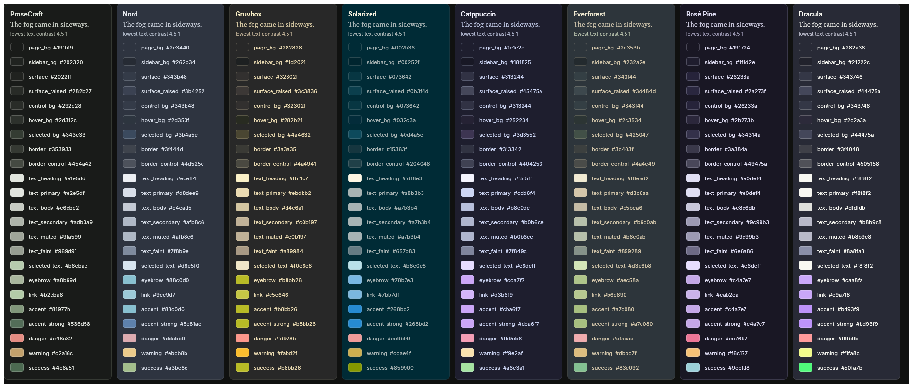
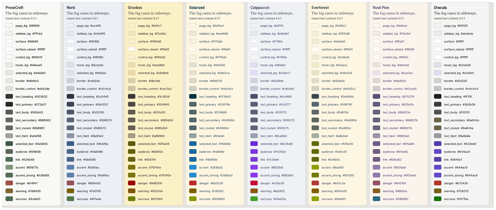

# ProseCraft-rs design

How ProseCraft-rs looks and why, as the code draws it today. There is no separate design file: the source of
truth is `crates/ui-egui`, and every value below names the place it comes from. The pictures are rendered from
the real palette and the real app (see [Screenshots](#screenshots)).

## Principles

- **ProseCraft's look, kept.** ProseCraft-rs is a rewrite of [ProseCraft](https://github.com/jennraeross/ProseCraft),
  and its pages are composed as ProseCraft composes them: the same views, the same order of things on each page,
  the same palette and words. Someone moving over from ProseCraft finds everything where it was.
- **egui and Craft conventions where they truly conflict.** Where a web page and a native app differ (menus,
  dialogs as windows, focus and keyboard handling, pickers), the app does what egui and the other Craft apps do:
  `craft_ui` tabs, combo boxes and pane host, `craft-menu` application menus. Data formats never change for the
  look: what is stored is exactly ProseCraft's.
- **Writing first.** The manuscript gets the middle of the window, a serif face and generous line spacing. The
  rest (binder, progress, comments) sits in quiet panes that can be hidden, and focus and Zen modes take them
  away entirely.
- **Readable in every scheme.** Text colours pass 4.5:1 against every surface they are drawn on, in all eight
  schemes, light and dark; a test enforces it (see [Accessibility](#accessibility)).

## Colour

`crates/ui-egui/src/theme.rs` defines `Palette`, the tokens the interface draws with, and `Palette::visuals`, which
maps them onto egui's `Visuals` (window, panel and widget fills, strokes, selection, hyperlinks).

### Tokens

| Token | Used for |
|---|---|
| `page_bg` | the central page behind every view |
| `sidebar_bg` | the binder and the right sidebar, the menu bar |
| `surface` | non-interactive frames, faint backgrounds |
| `surface_raised` | cards (outline chapters, comments, timeline moments, storyboard cards), windows, the selected segment |
| `control_bg` | inputs, buttons at rest, the segmented control's track, the goal bar's track |
| `hover_bg` | hovered rows, buttons and segments |
| `selected_bg` | the selected binder row, pressed and open widgets, text selection |
| `border`, `border_control` | hairlines around panes and cards; widget outlines |
| `text_heading` | page titles and headings (serif) |
| `text_primary` | interface text and the selected segment |
| `text_body` | manuscript text and read-only prose |
| `text_secondary` | unselected segments, secondary labels |
| `text_muted` | hints, counts, meta lines, the status line |
| `text_faint` | suggested relations in the network (not used for text that must be read) |
| `selected_text` | the text of the selected binder row and of selections |
| `eyebrow` | the small tracked capitals above sections ("CHAPTERS", "YOUR WRITING") |
| `quote`, `link` | block quotes; links, and the "love" and "mentor" relations |
| `accent`, `accent_strong` | the goal bar fill, active widget strokes, the "family" relation; the activity heat |
| `danger`, `warning`, `success` | destructive buttons and the "rival" relation; "employer"; "friend" |
| `heat[0..4]` | the writing-activity calendar, from no activity to the most |

### ProseCraft's own scheme

The default scheme is ProseCraft's CSS custom properties (`src/routes/+page.svelte`, upstream `7dae544`), dark by
default. A few of its values missed 4.5:1 for text and were moved just far enough; `theme.rs` marks each one.

| Token | Dark | Light |
|---|---|---|
| `page_bg` | `#191b19` | `#f8f8f6` |
| `sidebar_bg` | `#202320` | `#f1f1ed` |
| `surface` / `surface_raised` | `#20221f` / `#282b27` | `#fbfbf9` / `#ffffff` |
| `control_bg` | `#292c28` | `#fbfbf9` |
| `hover_bg` / `selected_bg` | `#2d312c` / `#343c33` | `#e9eae5` / `#e6e8e1` |
| `border` / `border_control` | `#353933` / `#454a42` | `#e8e8e3` / `#e0e2db` |
| `text_heading` / `text_primary` | `#e1e5dd` / `#e2e5df` | `#323832` / `#272a27` |
| `text_body` / `text_secondary` | `#c6cbc2` / `#adb3a9` | `#565b53` / `#666962` (from `#73766e`) |
| `text_muted` | `#9fa599` (from `#9da397`) | `#666961` (from `#999b94`) |
| `selected_text` | `#b6cbae` | `#3e5845` |
| `eyebrow` | `#a8b69d` | `#5f6858` (from `#87917f`) |
| `link` | `#b2cba8` | `#526e58` (from `#55715b`) |
| `accent` / `accent_strong` | `#81977b` / `#536d58` | `#81977b` / `#536d58` |
| `danger` | `#e48c82` (from `#ba6158`) | `#a14f47` (from `#ba6158`) |
| `warning` / `success` | `#c2a16c` / `#4c6a51` | `#7d6430` (from `#c2a16c`) / `#4c6a51` |

### The other seven schemes

Settings › General › Color scheme offers ProseCraft's eight schemes (`SCHEMES`): ProseCraft, Nord, Gruvbox,
Solarized, Catppuccin, Everforest, Rosé Pine and Dracula. Each of the seven is a set of primitives per mode
(`--p-base0…3`, `--p-fg…`, `--p-accent…`, from ProseCraft's `src/lib/color-schemes.css`), turned into tokens by
one shared mapping (`Palette::for_scheme`): `page_bg` is `base0`, `border` mixes 14 % of `fg` into `base1`,
`hover_bg` 7 % of the accent, and so on, as the CSS does. Every text token is then passed through `legible`,
which moves it toward black or white just far enough to reach 4.5:1 on every surface.

The sheets below are drawn from the real `Palette` values (the `shots_tokens` test), with each scheme's lowest
text contrast as the test measures it:





The theme is Settings › General › Theme: Follow system, Light or Dark.

## Typography

Fonts live in [craft-fonts](https://github.com/storytold/craft-fonts), not in this repository, and are embedded
at build time from `CRAFT_FONTS_DIR` (`crates/ui-egui/build.rs`, `src/fonts.rs`). Without a checkout, the app
builds with egui's and the system's fonts. Noto Sans Symbols and the installed system fonts are fallbacks for
everything else (emoji, every script).

| Family | Face | Roles |
|---|---|---|
| Proportional | Inter Regular | all interface text |
| `semibold` | Inter SemiBold | eyebrows and emphasis in the interface |
| `serif`, `serif-italic`, `serif-semibold` | Source Serif 4 | page titles and section headings, quoted passages in comments |
| `writing`, `writing-italic`, `writing-bold` | the chosen writing font, else Source Serif 4 | the manuscript |
| `markdown` | the chosen Markdown font, else egui's monospace | the Markdown source editor |

The writing font is Settings › Writing › Writing font, ProseCraft's list (Georgia, Bitter, Literata, IBM Plex
Serif, IBM Plex Sans, System Sans Serif, SF Mono) or any installed family; the first one of its stack that is
installed is used, otherwise Source Serif 4. Text size scales the manuscript (Settings › Writing › Text size).

| Role | Size (points) | Where |
|---|---|---|
| Page title | serif 38 | the scene or chapter title, "Outline", "Network", "Timeline" |
| Section headings | serif 17–32 | "Progress", "Comments", "Publish your manuscript", outline cards |
| Manuscript | writing 17, line height 1.85 | `views.rs` `body_format`, `layout_doc` (headings 1.3) |
| Interface | Inter 13–13.5 | buttons, binder rows (13.5), the view switch (13) |
| Secondary | Inter 12–11 | the status line, meta lines, hints, sidebar tabs (12) |
| Eyebrow | Inter SemiBold 10, capitals, tracking 1.3 | `widgets::eyebrow` |

## Layout

The window is a menu bar over three columns, managed by `craft_ui`'s pane host (`lib.rs` `ProseApp::show`):

- **Menu bar** (`app_menu.rs`): ProseCraft-rs, File, Edit, View, drawn by `craft-menu`; on macOS the native menu.
- **Binder** (left pane, docked, 280 wide, `binder.rs`): the project picker, its settings gear, Trash and "+",
  the author; CHAPTERS with the label filter and the chapter and scene rows (each with its label dot and a "⋯"
  menu, drag to reorder); WIKI with folders, pages, files and links; at the foot Open backup…, Export backup…,
  Settings… and the version.
- **Page** (centre, `views.rs`): the view switch (Outline, Write, Storyboard, Timeline when it is on, Network,
  Publish) with Search, the Chapters and Progress pane toggles, Shortcuts and, in Write, Split; the status line
  under it; then the view. Prose views keep to a centred column at most 720 wide (`COLUMN`).
- **Sidebar** (right pane, docked, 300 wide, `sidebar.rs`): the tabs Progress (project goal, chapter goals,
  writing calendar), Comments, Snapshots and Footnotes.

Pane bodies have an 18 × 16 margin. Either pane can be hidden from the view switch row (except on the
Storyboard), and focus mode (Ctrl+Shift+Enter) and Zen mode (hide the interface while typing) hide both and the
view switch.

### The views

| View | Composition |
|---|---|
| Outline | eyebrow OUTLINE, the project title, "N words in N chapters" and Add chapter, then a card per chapter: title, label, scene and word counts, summary |
| Write | the place (chapter or Wiki) and SCENE or PAGE, Move to Trash; the title (in a chapter, the chapter's); Story data (date, place, characters); the formatting toolbar; the text, with comment highlights and wiki mentions marked; the footer with the word count and save state. A scene opens inside its chapter, the other scenes drawn before and after it |
| Storyboard | the toolbar (Add blank card, Reset view, zoom, Select, Pan, Line, Arrow, Box, Text, Delete), the story elements list to drag from, and the dotted canvas of cards and drawings |
| Timeline | eyebrow FOLLOW YOUR STORY, the moments as numbered cards (title, date, time, description) with move and delete, Add moment |
| Network | eyebrow WIKI · NETWORK, counts and the legend (declared, suggested), Suggestions, Add relation; the Cards / Network / Matrix switch with the Kind and Type filters and Re-layout; the graph with its zoom, Fit and minimap; the chapter slider |
| Publish | the book's counts, Format cards, Style cards (and your own), Cover, front and back matter; on the right the live preview with its section navigator |
| Split view | up to five reference panes to the right of the editor, each with a picker, swap, move, add and close |

### Sheets and dialogs

Settings, the starter for a new project, project settings, labels, sources, the citation picker, the footnote
editor, find and replace, and the imports are egui windows over the page (`window_fill` = `surface_raised`,
1 px `border`, radius 10). Settings is a list of categories on the left (General, Writing, Proofreading, Data and
sync, About) and the category's groups on the right. The character card is a window in the Network view.

## Components

- **Segmented control** (`widgets::segmented`): the view switch, the sidebar tabs and the network modes. A track
  in `control_bg` with a 1 px `border` (radius 9, 3 inside); each segment is a `craft_ui` tab, role Tab, focusable,
  Enter or Space selects it; the selected one is `surface_raised` with `text_primary`, the rest
  `text_secondary`, hover `hover_bg`. Padding shrinks to fit the width.
- **Card** (`widgets::card`): `surface_raised`, 1 px `border`, radius 8, margin 14 × 12.
- **Eyebrow** (`widgets::eyebrow`): the section kicker, Inter SemiBold 10 in capitals, `eyebrow` colour.
- **Buttons and inputs:** egui's, styled by `Palette::visuals`: radius 6, `control_bg` with a `border_control`
  stroke at rest, `hover_bg` on hover, `selected_bg` with an `accent` stroke when pressed. Spacing: items 8 × 6,
  button padding 10 × 5, controls 26 high. Pickers are `craft_ui::ComboBox`.
- **Pane toggles** (Chapters, Progress, Split, Shortcuts): selectable labels, lit in `selected_bg` while on.
- **Choice cards** (Publish formats and styles): a card with a title, a monospace tag and a hint; the chosen one
  outlined in the accent. Role RadioButton.
- **Goal bar** (`widgets::goal_bar`): 5 high, `control_bg` track, `accent` fill; role ProgressIndicator with
  "N% of goal".
- **Chips:** the label dot in the binder (the label's colour), relation type chips in the network.
- **The graph** (`relation_graph.rs`): pages as circles with their initials and names under them, declared
  relations as arrows coloured by type (family `accent`, friend `success`, rival `danger`, love `quote`, mentor
  `link`, employer `warning`) with their label at the middle, suggestions as dashed lines in `text_faint` with
  the number of shared scenes; drag, scroll or pinch to zoom, a minimap in the corner.
- **Writing calendar** (`sidebar.rs` `activity`): a month of day cells shaded through `heat`.

## Accessibility

The rules are Craft's [accessibility house rules](https://github.com/storytold/craft-contrib/blob/main/standards/house-rules-accessibility.md).
As implemented:

- **AccessKit everywhere.** Every control has a role and a name (`views::name_field`, `accesskit_node_builder`):
  the view switch and sidebar tabs are Tabs, binder rows TreeItems, the style and format cards RadioButtons,
  pickers ComboBoxes with their label, the goal bar a ProgressIndicator. The manuscript
  editor is a drawn surface that publishes AccessKit text nodes with the caret, selection and editability.
- **Keyboard.** Tabs, cards and buttons take focus and answer Enter and Space; the storyboard has keyboard
  alternatives to dragging (arrow keys move a card); Ctrl+F searches, Ctrl+Shift+Enter is focus mode, Ctrl+/
  lists the shortcuts.
- **Contrast.** Every text token (`text_primary`, `text_heading`, `text_body`, `text_secondary`, `text_muted`,
  `selected_text`, `eyebrow`, `quote`, `link`, `danger`, `warning`) is at least 4.5:1 on every surface (`page_bg`,
  `sidebar_bg`, `surface`, `surface_raised`, `control_bg`, `hover_bg`, `selected_bg`), in every scheme, light and
  dark: `theme::tests::every_text_colour_passes_on_every_surface`. `text_faint`, `accent` and `success` are
  outside that rule and are not used for text that has to be read.
- The UI tests (`crates/ui-egui/tests/`) drive the app by keyboard and through the AccessKit tree.

## Screenshots

Every picture in the README and here is the app, rendered offscreen with egui_kittest and wgpu (never a screen
capture), by `crates/ui-egui/tests/shots.rs`. It opens
[`tests/showcase/the-glass-orchard.prosecraft`](../crates/ui-egui/tests/showcase/the-glass-orchard.prosecraft), a
short novel invented for the pictures (chapters, scenes, comments, a footnote, a citation, labels, wiki pages with
character sheets and relations, storyboard cards, timeline moments, goals and writing activity), as the library
file the app starts with, and drives the interface to each view at 1440 × 900. It needs a GPU or a software Vulkan
driver, and it refuses to run without the app's fonts, so no picture shows a fallback face:

```sh
git clone https://github.com/storytold/craft-fonts ../craft-fonts
PROSECRAFT_SHOTS=docs/screenshots CRAFT_FONTS_DIR=$PWD/../craft-fonts \
  cargo test -p prosecraft-ui-egui --test shots -- --ignored shots
optipng -o5 -strip all docs/screenshots/*.png     # optional: smaller files, the same pixels
```

`PROSECRAFT_SHOTS` is relative to the workspace root. `shots` writes the app's pictures (`write`, `outline`,
`storyboard`, `network`, `publish`, `split`, `focus`, `settings`, `write-light`), `shots_tokens` the two token
sheets. The test is compiled by every `cargo xtask ci`, so it keeps up with the interface.
